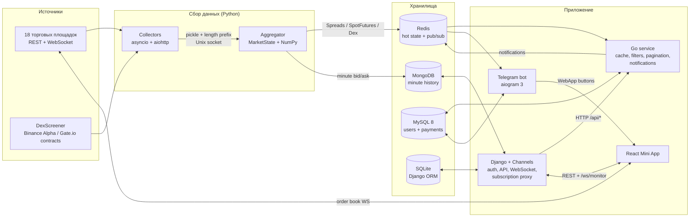

# FundingRadar

Платформа для поиска и мониторинга арбитражных связок на криптовалютных рынках: **фьючерс/фьючерс**, **спот/фьючерс** и **DEX/фьючерс**.

FundingRadar собирает ставки финансирования, bid/ask, объёмы и лимиты с 18 торговых площадок, Binance Alpha и DEX-пулов через DexScreener, считает спреды входа и выхода, хранит минутную историю и отдаёт результат в Telegram-бот, Telegram Mini App и публичные веб-страницы.

Проект вырос из Python-прототипа в гибридную систему: I/O-тяжёлый сбор данных остаётся на `asyncio`, поиск по рыночным матрицам выполняется через NumPy, read-heavy API и уведомления вынесены в Go, а Django отвечает за аутентификацию, WebSocket, подписки и админку.

`Python 3.14` · `Django 6` · `Go 1.22` · `React 19` · `Redis` · `MongoDB` · `MySQL` · `Docker Compose`

Продукт: [fundingradar.ru](https://fundingradar.ru)

## Что умеет

- Искать рыночно-нейтральные связки трёх типов: фьючерс/фьючерс, спот/фьючерс и DEX/фьючерс.
- Собирать данные с Bybit, Binance, OKX, Gate.io, Bitget, KuCoin, MEXC, HTX, BingX, BitMart, Ourbit, Hyperliquid, LBank, Aster, XT, CoinEx, WEEX и Phemex, а также с Binance Alpha и DEX через DexScreener.
- Показывать funding spread, спред входа/выхода, комиссии, 24-часовой объём и доступные лимиты.
- Присылать уведомления в Telegram по порогам, выбранным биржам и чёрному списку монет.
- Строить графики спреда по минутной истории bid/ask и показывать live-стакан с бирж.
- Работать как Telegram Mini App с публичными страницами, тарифами, FAQ, списком бирж и рейтингом funding rate.
- Поддерживать trial-доступ, платную подписку, рефералов и ограничение количества устройств для подписочных ссылок.

## Архитектура



Система разделена на два контура:

- **Data plane** — Python-коллекторы, Unix-socket-агрегатор, Redis и MongoDB. Здесь данные собираются, нормализуются, проверяются на свежесть и превращаются в готовые снимки связок.
- **Serving plane** — Go-сервис, Django, Telegram-бот и React. Go обслуживает массовые чтения из памяти, Django отвечает за auth/WebSocket/подписки, бот доставляет уведомления, Mini App показывает данные пользователю.

Такое разделение позволяет не проксировать высокочастотные рыночные данные через Django и не выполнять тяжёлый поиск в процессе, который обслуживает HTTP-запросы.

## Стек

| Слой | Технологии |
|---|---|
| Сбор данных | Python 3.14, `asyncio`, `aiohttp`, WebSocket-клиенты, NumPy, `orjson` |
| Агрегация | Python `multiprocessing`, Unix domain sockets, pickle-протокол с length-prefix |
| API и уведомления | Go 1.22, `net/http`, `go-redis`, `go-sql-driver/mysql`, `atomic.Value` |
| Web/API | Django 6, Django REST Framework, SimpleJWT, Channels, Daphne, Motor |
| Telegram | aiogram 3, Telegram WebApp, Redis |
| Frontend | React 19, React Router 7, Chart.js, i18next, `@tma.js/sdk`, axios |
| Хранилища | Redis, MongoDB 6, MySQL 8, SQLite |
| Инфраструктура | Docker Compose, Nginx, HAProxy, Certbot, Let's Encrypt |

## Как это работает

1. **Сбор.** Два основных коллекторных процесса опрашивают торговые площадки: `funding_bot/collectors/bybit.py` обслуживает Bybit, MEXC, OKX, Binance, BingX, BitMart, XT, CoinEx, WEEX, Phemex и Binance Alpha; `funding_bot/collectors/kucoin.py` — KuCoin, Gate.io, Bitget, HTX, Ourbit, Hyperliquid, LBank и Aster. Внутри каждого процесса независимые async-loop'ы работают параллельно. Отдельные коллекторы поддерживают актуальные contract-адреса Gate.io и Binance Alpha, а `dexscreener.py` забирает цены DEX-пулов.
2. **Передача.** Коллекторы отправляют батчи в агрегатор через Unix domain socket. Формат — 4-байтовый big-endian заголовок длины и pickle-полезная нагрузка. Это дешевле сетевого брокера для обмена внутри одного хоста и изолирует сборщики от процесса поиска.
3. **Агрегация.** `MarketState` хранит котировки в NumPy-матрицах `(symbols × markets)`, проверяет свежесть данных и выполняет поиск связок. Результаты поиска — это готовые записи для Redis, а не «сырые» ответы бирж.
4. **Публикация.** Каждые ~2 секунды агрегатор пересобирает снимки и пишет их в Redis. Раз в минуту отдельный loop сохраняет последние bid/ask в MongoDB для истории. Запись в Mongo выполняется отдельным процессом через очередь и батчи.
5. **Чтение.** Go-сервис подписывается на Redis pub/sub, обновляет in-memory кэши и поддерживает заранее отсортированные представления данных. HTTP-запросы читают только память и не ходят в Redis/MySQL на каждый запрос.
6. **Отдача.** Django выступает API-шлюзом: для приватных рыночных запросов проверяет JWT и подписку, проксирует их в Go, отдаёт историю из MongoDB и обслуживает WebSocket. React-клиент получает готовые страницы, графики и live-стакан.
7. **Уведомления.** Go применяет пользовательские фильтры и складывает события в Redis-списки. Python-бот забирает пачки через атомарный `RENAME`, группирует их по пользователю и монете и отправляет сообщения в Telegram.

## Алгоритмы

### Фьючерс/фьючерс

Для каждой пары торговых площадок и каждой монеты проверяются свежесть котировок, ненулевые bid/ask и пользовательский blacklist. Пары нормализуются так, чтобы `market1` была ногой с более высокой ставкой финансирования, а `funding spread` — неотрицательным.

| Метрика | Формула |
|---|---|
| Funding spread | `funding1 - funding2` |
| Вход, прямое направление | `(bid1 / ask2 - 1) * 100` |
| Выход, прямое направление | `(ask1 / bid2 - 1) * 100` |
| Вход, обратное направление | `(bid2 / ask1 - 1) * 100` |
| Выход, обратное направление | `(ask2 / bid1 - 1) * 100` |

Прямое направление соответствует продаже на `market1` и покупке на `market2`; обратное — наоборот. Комиссии, 24-часовой объём и лимиты передаются вместе со связкой и отображаются в интерфейсе, чтобы пользователь видел стоимость входа и реалистичность объёма.

### Спот/фьючерс

Здесь `market1` — спотовая площадка, `market2` — фьючерсная. Funding rate начисляется по фьючерсной ноге, а спред входа считается между ценой покупки спота и ценой продажи перпетуала.

| Метрика | Формула |
|---|---|
| Funding carry | `market2funding` |
| Вход | `(market2bid / spot1ask - 1) * 100` |
| Выход | `(market2ask / spot1bid - 1) * 100` |

### DEX/фьючерс

DEX-цена сопоставляется с фьючерсной ценой на CEX. Для каждой пары считается отклонение и доступный funding rate:

```text
diff = (cex_bid / dex_price - 1) * 100
```

В запись также попадают контракт, сеть, ссылка на DEX-пул, объём и `dexId`. Это позволяет переходить из интерфейса сразу к токену и торгуемой паре.

### Почему поиск быстрый

- Котировки хранятся не в списках Python-объектов, а в NumPy-матрицах; проверка свежести, нулевых цен и blacklist выполняется векторными масками.
- Поиск фьючерс/фьючерс идёт по парам рынков, а внутри пары — векторно по всем символам. Для 19 рынков в `MarketState` (18 площадок и Binance Alpha) это заметно дешевле, чем вложенный перебор всех записей.
- DEX-поиск инкрементальный: пересчитываются только токены, у которых изменилась цена.
- Устаревшие котировки отсекаются по `DATA_MAX_AGE` (по умолчанию 15 секунд), поэтому в выдачу не попадают «зависшие» стаканы.
- Для DexScreener используется token-bucket rate limiter на 550 запросов в минуту, батчи по 30 адресов и до 10 параллельных запросов; список контрактов перечитывается раз в минуту.

## Данные и хранилища

| Хранилище | Что хранит | Зачем |
|---|---|---|
| Redis DB 0 | `Spreads:all`, `Notifications:Spreads`, `BinanceAlpha:contracts` | Горячий снимок фьючерс/фьючерс, очередь уведомлений и метаданные контрактов |
| Redis DB 1 | `SpotFutures:all`, `Notifications:SpotFutures` | Горячий снимок спот/фьючерс и уведомления |
| Redis DB 2 | `Dex:all`, `Dex:meta`, `Notifications:Dex` | DEX/фьючерс-связки, метаданные обновлений и уведомления |
| Redis pub/sub | `Spreads:update`, `SpotFutures:update`, `Dex:update`, `NotificationsPub:Flush` | События обновления снимков и сигнал о новой пачке уведомлений; каналы pub/sub не привязаны к номеру DB |
| MongoDB `funding.futures`, `funding.spot` | Минутные документы `{exchange_name, symbol, datetime, ask, bid}` | История для графиков; TTL-индекс удаляет данные через 48 часов, есть составной индекс по бирже, символу и времени |
| MySQL 8 `funding` | `Users`, `Paids`, `Spreads`, `SpotFutures`, `futures`, `spot` | Операционные настройки пользователей и платежи; часть таблиц — legacy первой версии |
| SQLite `db.sqlite3` | Пользователи Django, история входов, устройства, персональные лимиты подписок | Auth, админка и аудит в текущей конфигурации Django ORM |

Django-пользователь создаётся по `telegram_id`. При входе Django синхронизирует статус подписки и trial-период из MySQL-таблицы `Users`, а собственные данные (IP-логи, устройства, настройки лимитов) хранит в SQLite. Это отражает эволюцию проекта: legacy-контур уже работал с MySQL, а Django-часть развивалась отдельно. Унификация хранилища — один из пунктов плана развития.

### Что важно в модели данных

- `Users.lastNoticeCoins` и blacklist-поля хранятся в сжатом BLOB, чтобы не раздувать таблицу тысячами строк истории уведомлений.
- Redis-снимки содержат не только цены, но и комиссии, объёмы, лимиты, funding interval и служебные флаги — Go-сервису не нужно дочитывать данные из других источников.
- Для каждой пары в Redis есть нормализованные ключи `market1`/`market2`, поэтому API и бот используют один и тот же контракт данных.

## API и realtime

### Django API

| Endpoint | Назначение |
|---|---|
| `POST /api/auth/telegram/` | Проверка Telegram `initData` и выдача JWT |
| `POST /api/token/refresh/` | Обновление access-токена |
| `GET /api/coins/` | Список доступных монет |
| `GET /api/get_futures/`, `/api/get_futures_pages/`, `/api/get_futures_id/` | Фьючерс/фьючерс: список, страница по монете, детали пары |
| `GET /api/get_spot/`, `/api/get_spot_pages/`, `/api/get_spot_id/` | Спот/фьючерс: список, страница по монете, детали пары |
| `GET /api/get_dex/`, `/api/get_dex_pages/`, `/api/get_dex_id/` | DEX/фьючерс: список, страница по токену, детали пары |
| `GET /api/get_subscribe/` | Статус подписки, trial, даты, рефералы |
| `POST /api/update-depth/` | Сохранение выбранной глубины стакана |
| `GET /api/top-funding/`, `/api/top-funding-spot/` | Публичные топы по funding rate |
| `GET /api/proxy/<sub_id>` | Прокси подписочных ссылок с проверкой устройства |

Внутренний Go-сервис слушает `:8081` и предоставляет `/api/futures`, `/api/spot`, `/api/dex`, страницы, детали и топы. Django вызывает его по HTTP, а для приватных запросов добавляет проверку JWT/подписки. Параметры пагинации — `page`, `items` (до 200), `sort=funding|spread`, `lt=0|1`.

### WebSocket

`MonitorConsumer` доступен по адресу `/ws/monitor/?token=<JWT>`:

- проверяет access-токен и активную подписку;
- отдаёт исторические серии спреда из MongoDB;
- держит live-обновления и периодический ping;
- по действию `dex_subscribe` запускает общий poller для DEX-символа: один цикл чтения Redis на символ, рассылка всем подписчикам через Channels group, остановка при отсутствии подписчиков;
- пересчитывает normal/reverse-серии из минутных bid/ask и отправляет данные для Chart.js.

## Клиенты

### Telegram Mini App

React-приложение открывается и внутри Telegram, и как обычный сайт. Публичные страницы — лендинг, тарифы, FAQ, список бирж, funding rates — доступны без Telegram SDK. Приватные страницы (`/trade/...`, `/spreads`, `/subscription`, `/info`) используют `initData` и JWT.

- Режимы таблицы: фьючерс/фьючерс, спот/фьючерс, DEX.
- Поиск по монете, пагинация, автообновление, фильтры по входу/funding, знаку спреда и пороги для уведомлений.
- Графики спреда и live-стакан.
- Прямые WebSocket-коннекторы к поддерживаемым биржам для получения стакана в браузере: высокочастотные рыночные данные не проходят через backend.
- Локализация на русский и английский, адаптивная вёрстка для мобильных и десктопа.

### Telegram-бот

Бот на aiogram 3 повторяет основные сценарии Mini App и добавляет уведомления:

- меню «Фьючерсы», «Спот/Фьючерсы», DEX;
- пагинация, фильтры, настройка порогов и чёрных списков;
- управление подпиской, trial-доступом, рефералами и реквизитами;
- inline-кнопки с переходом в Mini App для графика;
- отдельный listener забирает уведомления из `Notifications:Spreads`, `Notifications:SpotFutures` и `Notifications:Dex`, группирует их и отправляет не более 15 сообщений на пользователя за проход.

## Аутентификация и подписка

- Telegram `initData` проверяется через HMAC-SHA256 с ключом `WebAppData`, дополнительно контролируется `auth_date` (не старше 24 часов).
- После успешной проверки создаётся или обновляется Django-пользователь с `telegram_id`, синхронизируется подписка из MySQL и возвращается пара SimpleJWT access/refresh.
- Приватные рыночные API-endpoint'ы и WebSocket проверяют `test_active`/`subscribe_active`; при отсутствии доступа возвращается `status: no_sub`.
- История входов и IP-адреса пишутся в `UserLoginRecord`; middleware учитывает `X-Real-IP`/`X-Forwarded-For`.
- Для подписочных ссылок ведётся отдельный реестр устройств: HWID или fallback-идентификатор по UA, лимит устройств (по умолчанию 2), блокировка браузерных и ботовых запросов, удаление записей, неактивных более 30 дней, при проверке устройства.
- Сам subscription proxy переписывает адреса в ответе origin-сервера на публичный хост, поддерживает plain-text и base64-подписки и возвращает только разрешённые заголовки.

## Инфраструктура

- **Docker Compose** поднимает MySQL, Redis, MongoDB, Django, Telegram-бота, агрегатор, коллекторы, Go-сервис и Nginx. Для production и разработки есть отдельные compose-файлы; у сервисов заданы лимиты CPU/памяти и `nofile`.
- **Nginx** собирает React-приложение в multi-stage-образе, раздаёт статику, проксирует `/api`, `/admin`, `/ws/` и Django static, обслуживает ACME-challenge и перенаправляет HTTP на HTTPS.
- **HAProxy** работает в TCP-режиме на `443`, маршрутизирует трафик по SNI и передаёт веб-трафик в Nginx на `8443` с PROXY protocol. Через него также проходит служебный TCP-трафик; в детали этой части README не углубляется.
- **Certbot** выпускает и обновляет сертификаты Let's Encrypt через webroot.
- **AutoStart.py** запускает Daphne и раз в 30 секунд проверяет `/api/coins/`; при недоступности процесс поднимается заново.

## Тесты

```bash
# Python: MarketState, поиск, коллекторы, интеграции, security
pytest

# Go: unit-тесты сервиса
go -C trading test ./...

# React: тесты фронтенда
cd frontend && npm test -- --watchAll=false
```

Покрыты:

- загрузка и нормализация котировок в `MarketState`, проверки свежести, blacklist и метаданные;
- алгоритмы поиска фьючерс/фьючерс и спот/фьючерс;
- парсинг и обработка ответов Bybit, Binance Alpha, Aster, Phemex, XT, WEEX;
- паритет DEX-ответов Go-сервиса и Python-бота;
- интеграционные сценарии с Redis, MySQL, Django и Go;
- unit-тесты Go-сервиса и React-утилит.

Интеграционные тесты требуют запущенных Redis, MySQL и Go-сервиса; большинство unit-тестов не требует инфраструктуры.

## Структура репозитория

```text
FundingRadar/
├── funding_web/          Django project: settings, ASGI, URLs
├── trading/              Django app, WebSocket consumer, Go service, migrations
├── funding_bot/
│   ├── collectors/       CEX/DEX-коллекторы и contract-поллеры
│   ├── core/             MarketState и NumPy-поиск связок
│   ├── libs/             фильтры, форматирование, клиент Go API
│   ├── routers/          пагинация и экраны Telegram-бота
│   ├── tests/            pytest- и интеграционные тесты
│   ├── aggregator.py     Unix-socket-сервер, поиск, Mongo writer
│   └── CryptoTGbot.py    aiogram-бот и доставка уведомлений
├── frontend/             React Mini App
├── nginx/                TLS, статика, reverse proxy
├── haproxy/              TCP/SNI-routing
├── scripts/              вспомогательные скрипты
├── docker-compose.yml
├── docker-compose.dev.yml
├── Dockerfile_*
├── requirements.txt
└── manage.py
```

## Запуск

Секреты и адреса сервисов задаются через окружение: `.env_dev` для локальной разработки, `.env` для production и `frontend/.env` для Mini App. Шаблон production-переменных — [`.env.example`](.env.example); шаблоны фронтенда — [`frontend/.env_example`](frontend/.env_example) и [`frontend/.env_example_dev`](frontend/.env_example_dev).

```bash
# Локальная разработка (docker-compose.dev.yml)
make dev

# Production-сборка и запуск (docker-compose.yml)
make prod
```

## Развёртывание на Timeweb с нуля

Ниже — production-сценарий для чистого сервера **Ubuntu 24.04**. Выполняйте команды по порядку; замените только заглушки:

- `203.0.113.10` — на публичный IP сервера;
- `you@example.com` — на email для Let's Encrypt;
- `fundingradar.ru` — на ваш домен, если он отличается.

### 1. Сервер и SSH-ключ

Создайте сервер в панели Timeweb: Ubuntu 24.04, публичный IPv4, SSH-ключ. В DNS добавьте A-запись `fundingradar.ru` (это пример, нужен ваш домен) на IP сервера. В firewall Timeweb откройте `22`, `80` и `443`; не открывайте наружу `3306`.

Сгенерируйте SSH-ключ на локальном компьютере:

```bash
ssh-keygen -t ed25519 -C "you@example.com"
cat ~/.ssh/id_ed25519.pub
```

Скопируйте весь вывод, который начинается с `ssh-ed25519 AAAA...`. Перейдите в GitHub → Settings → SSH and GPG keys → New SSH key, вставьте содержимое `id_ed25519.pub` и назовите ключ, например, `VPS Ubuntu 24.04`.

### 2. DNS через systemd-resolved

Ubuntu 24.04 использует `systemd-resolved`, и он управляет `/etc/resolv.conf`. Проверьте его статус:

```bash
systemctl status systemd-resolved
```

Если сервис активен, задайте DNS через него:

```bash
sudo mkdir -p /etc/systemd/resolved.conf.d
sudo nano /etc/systemd/resolved.conf.d/dns.conf
```

Добавьте в файл:

```ini
[Resolve]
DNS=1.1.1.1 8.8.8.8
FallbackDNS=9.9.9.9
```

Перезапустите сервис и проверьте DNS:

```bash
sudo systemctl restart systemd-resolved
ping github.com
```

### 3. Проверка SSH и клонирование

```bash
ssh -T git@github.com
git clone git@github.com:xAlexandr/FundingRadar.git
cd FundingRadar
git branch -a
git checkout main
git pull
```

Для `ssh -T` должно появиться сообщение вида `Hi username!`.

### 4. Настройка окружения

Настройте `FundingRadar/.env` по примеру `.env.example`. Для production используйте `frontend/.env_example`, для локальной разработки — `frontend/.env_example_dev`; сами файлы не перезаписывайте.

### 5. `users_data.sql` и база данных

`users_data.sql` — это дамп **только данных** таблицы `Users` из существующей MySQL, а не структура базы. В репозитории этого файла нет — он не коммитится. Отдельная команда для создания БД не нужна: схема создастся из `dump_structure.sql` при первом запуске MySQL с пустым volume. Для чистой установки файл не обязателен.

Если нужно перенести старых пользователей, сделайте дамп на старом сервере — команда создаст `users_data.sql`:

```bash
make dump-users
```

Затем скопируйте файл на новый сервер:

```bash
sudo scp users_data.sql root@203.0.113.10:/root/FundingRadar/users_data.sql
```

Если `users_data.sql` нет, этот шаг и последующий `sudo make load-users` нужно пропустить: `make load-users` сначала очищает таблицу `Users`, а затем загружает файл.

### 6. Make и Docker

Установите `make`:

```bash
sudo apt-get install make
```

Установите Docker:

```bash
# Add Docker's official GPG key:
sudo apt update
sudo apt install ca-certificates curl
sudo install -m 0755 -d /etc/apt/keyrings
sudo curl -fsSL https://download.docker.com/linux/ubuntu/gpg -o /etc/apt/keyrings/docker.asc
sudo chmod a+r /etc/apt/keyrings/docker.asc

# Add the repository to Apt sources:
sudo tee /etc/apt/sources.list.d/docker.sources <<EOF
Types: deb
URIs: https://download.docker.com/linux/ubuntu
Suites: $(. /etc/os-release && echo "${UBUNTU_CODENAME:-$VERSION_CODENAME}")
Components: stable
Signed-By: /etc/apt/keyrings/docker.asc
EOF

sudo apt update

sudo apt install docker-ce docker-ce-cli containerd.io docker-buildx-plugin docker-compose-plugin
```

### 7. Запуск приложения

```bash
sudo make prod
sudo make up-haproxy
```

Если переносите пользователей и `users_data.sql` уже загружен, выполните:

```bash
sudo make load-users
```

Для чистой установки без `users_data.sql` эту команду нужно пропустить: она сначала очищает таблицу `Users`, а затем пытается загрузить файл.

### 8. После запуска обязательно для индексации MongoDB

```bash
sudo make init-indexes
```

### 9. Настройка UFW

```bash
# Базовый профиль ufw (тот же, что и раньше)
sudo ufw default deny incoming
sudo ufw default allow outgoing

# SSH (обязательно)
sudo ufw allow 22/tcp
sudo ufw limit 22/tcp

# Закрываем MySQL наружу
sudo ufw deny 3306/tcp

# Веб (haproxy)
sudo ufw allow 80/tcp
sudo ufw allow 443/tcp
```


